# 🦸‍♂️ Protocolo Vingadores

- **Aluno:** Anny Karolliny de Oliveira Silva
- **Matrícula:** 20260010220
- **Curso:** Bacharelado em Sistemas de Informação na UFRN
- **Disciplina:** DCT1106 - Programação
- **Docente:** Thommas Kevin Sales Flores
- **Linguagem:** C (Padrão C99)

## 📖 História

A Terra enfrenta suas maiores ameaças. O jogo se passa em três eras distintas do universo cinematográfico dos Vingadores, onde o jogador deve assumir o papel de um dos heróis mais poderosos da Terra para conter invasões alienígenas, exércitos de robôs e o poder cósmico de um Titã Louco. A missão final é salvar o planeta e impedir a extinção da humanidade.

## 🎮 Dinâmica do jogo

* **Movimentação:** O jogador lança um dado de 6 lados (d6) no início de cada turno para avançar no tabuleiro. O tabuleiro possui 15 casas e o jogador não pode ultrapassar a última casa.
* **Tipos de Casa:** O tabuleiro possui eventos aleatórios representados por ícones:
  * `[ ]` Área Vazia (nada acontece)
  * `[X]` Combate (inicia uma batalha contra um lacaio da fase)
  * `[$]` Tesouro (ganha um bônus aleatório de atributo)
  * `[+]` Cura (recupera 25 de vida)
  * `[!]` Armadilha (perde 15 de vida)
  * `[C]` Chefe Final (inicia o combate contra o vilão principal da fase)
* **Funcionamento do Combate:** Ocorre por turnos. O jogador escolhe entre Atacar, Defender, usar a Habilidade Especial ou Fugir.
  * **Fórmula de Ataque do Jogador:** `Dano = max(1, (d20 + Atributo Principal) - Defesa do Monstro)`. O Atributo Principal varia: Força (Hulk), Inteligência (Homem de Ferro) ou Agilidade (Viúva Negra).
  * **Fórmula de Ataque do Monstro:** `Dano = max(1, (d20 + Ataque do Monstro) - Defesa do Jogador)`.
  * **Ação Defender:** O dano recebido no próximo turno é reduzido pela metade.
  * **Fuga:** O jogador rola `d20 + Agilidade`. Se o resultado for maior ou igual a 15, ele foge. **Não é possível fugir dos Chefes.**
  * **Habilidade Especial:** Possui um *cooldown* de 3 turnos (só pode ser usada a partir do 3º turno).
* **Recompensas e Evolução:** Ao derrotar um monstro, o jogador ganha XP e um bônus aleatório (Força, Defesa, Agilidade, Inteligência ou Vida Máxima). Ao acumular 100 XP, o herói sobe de nível, recupera toda a vida e ganha +2 em todos os atributos.
* **Condições de Vitória e Derrota:** 
  * **Vitória:** O jogador vence ao derrotar o Chefe da Fase 3 (Thanos).
  * **Derrota:** O jogador perde se sua vida chegar a 0 durante qualquer combate ou armadilha.
  * Monstros já derrotados não reaparecem, rendendo apenas +5 XP ao serem encontrados novamente.
    
## 🦸‍♂️ Personagens jogáveis

O jogador pode escolher entre três heróis, cada um com atributos e estilos de combate únicos:

| Herói | Arma / Armadura | Vida | Força | Defesa | Agilidade | Inteligência | Habilidade Especial |
| :--- | :--- | :---: | :---: | :---: | :---: | :---: | :--- |
| **Hulk** | Punhos Esmagadores / Pele Resistente | 150 | **18** | 8 | 6 | 4 | **Hulk Smash:** Dano massivo baseado em Força. |
| **Homem de Ferro** | Repulsores / Armadura Mark L | 110 | 12 | **16** | 10 | **18** | **Unibeam:** Feixe de energia baseado em Inteligência. |
| **Viúva Negra** | Mordidas da Viúva / Traje Furtivo | 85 | 10 | 8 | **20** | 15 | **Ataque Furtivo:** Dano crítico baseado em Agilidade. |

### 🖼️ Galeria de heróis

<div align="center">
  <table>
    <tr>
      <td align="center"><b>Hulk</b></td>
      <td align="center"><b>Homem de Ferro</b></td>
      <td align="center"><b>Viúva Negra</b></td>
    </tr>
    <tr>
      <td>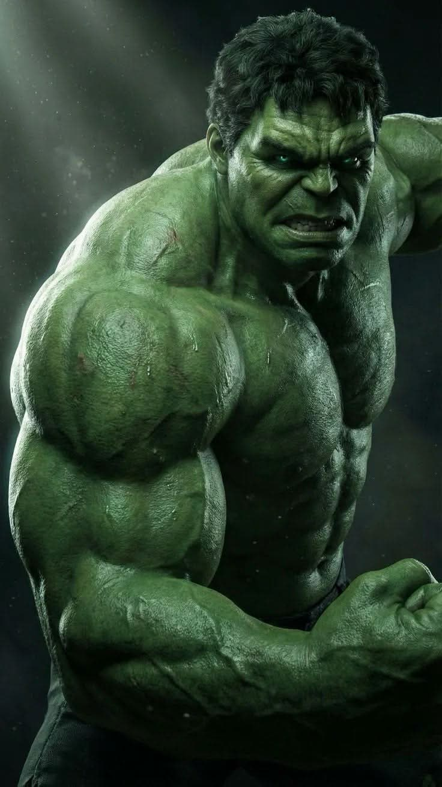</td>
      <td>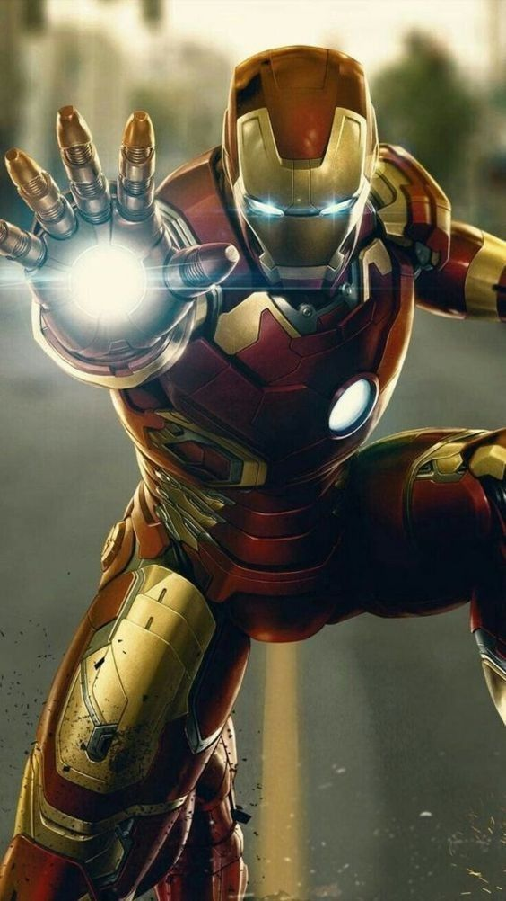</td>
      <td>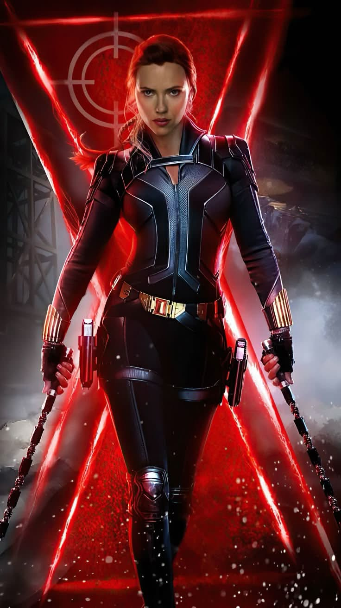</td>
    </tr>
  </table>
</div>

## 👹 Vilões e fases

O jogo é dividido em 3 fases, com dificuldade progressiva e 3 monstros por fase.

### Fase 1: Batalha de Nova York
*   **História:** Loki roubou o Tesseract e abriu um portal sobre a Torre Stark. Criaturas Chitauri e agentes infiltrados da Hidra estão dominando as ruas.
*   **Missão:** Impedir a invasão e derrotar Loki.
*   **Monstros:**
    1.  **Agente da Hidra** (Vida: 35 | Ataque: 6 | Defesa: 2)
    2.  **Mercenário Chitauri** (Vida: 45 | Ataque: 8 | Defesa: 4)
    3.  **Loki (Chefe)** (Vida: 80 | Ataque: 10 | Defesa: 5)

<div align="center">
  <table>
    <tr>
      <td align="center"><b>Agente da Hydra</b></td>
      <td align="center"><b>Mercenário Chitauri</b></td>
      <td align="center"><b>Loki</b></td>
    </tr>
    <tr>
      <td>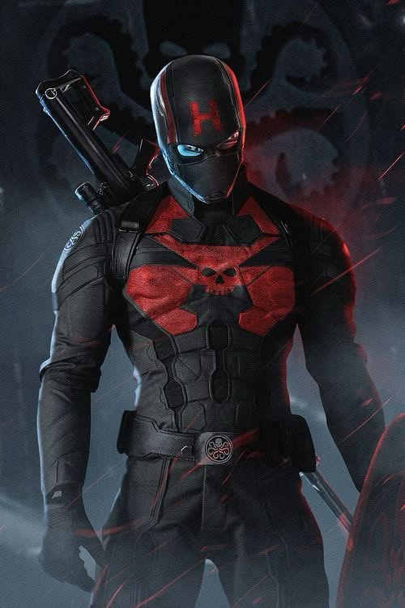</td>
      <td>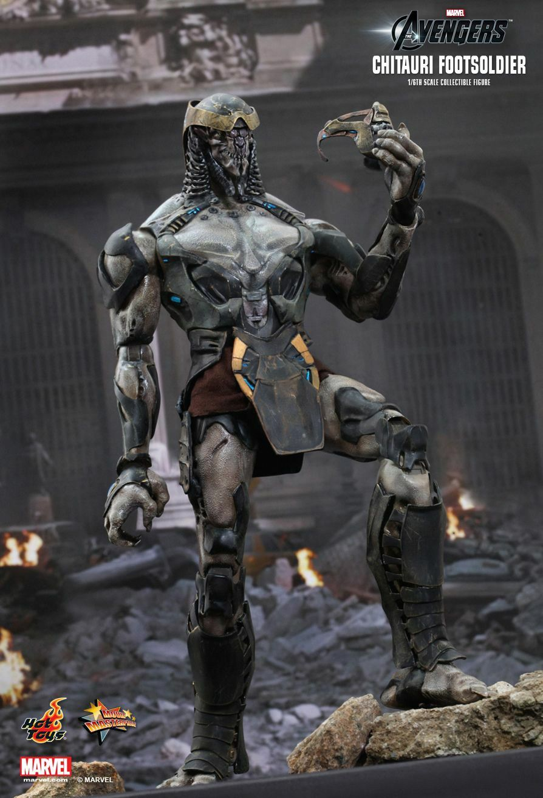</td>
      <td>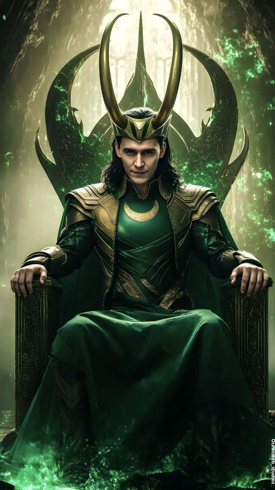</td>
    </tr>
  </table>
</div>

### Fase 2: A Era de Ultron
*   **História:** Ultron despertou e quer a extinção da humanidade. Ele construiu um exército de robôs em uma fábrica secreta na Sokovia.
*   **Missão:** Invadir a fábrica e destruir o núcleo de Ultron.
*   **Monstros:**
    1.  **Robô de Ultron** (Vida: 60 | Ataque: 10 | Defesa: 6)
    2.  **Drone Bombardeiro** (Vida: 55 | Ataque: 12 | Defesa: 4)
    3.  **Ultron Prime (Chefe)** (Vida: 110 | Ataque: 14 | Defesa: 8)

 <div align="center">
  <table>
    <tr>
      <td align="center"><b>Robô de Ultron</b></td>
      <td align="center"><b>Drone Bombardeiro</b></td>
      <td align="center"><b>Ultron Prime</b></td>
    </tr>
    <tr>
      <td>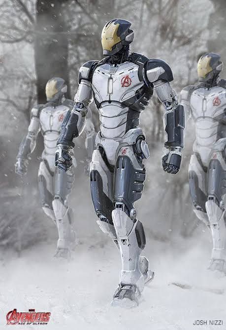</td>
      <td>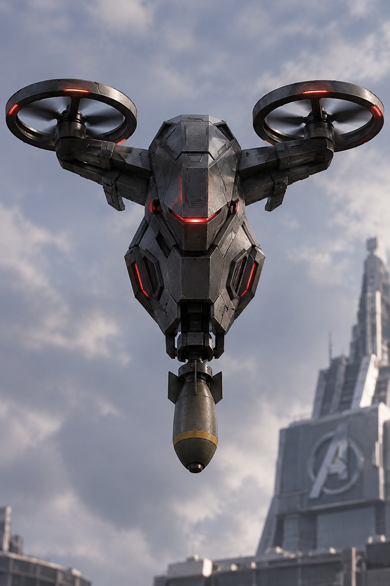</td>
      <td>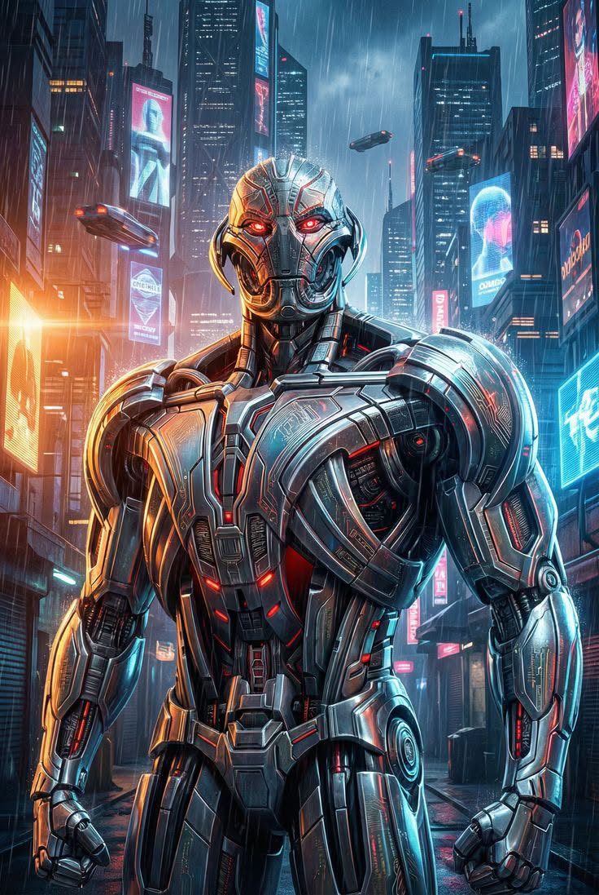</td>
    </tr>
  </table>
</div>

### Fase 3: Guerra do Infinito
*   **História:** Thanos chegou. Com as Joias do Infinito, ele está a um estalo da vitória. A Ordem Negra espalha o caos pelo universo.
*   **Missão:** Enfrentar a Ordem Negra e derrotar Thanos.
*   **Monstros:**
    1.  **Outrider** (Vida: 80 | Ataque: 14 | Defesa: 7)
    2.  **Corvus Glaive** (Vida: 70 | Ataque: 16 | Defesa: 6)
    3.  **Thanos (Chefe Final)** (Vida: 160 | Ataque: 20 | Defesa: 12)
 
<div align="center">
  <table>
    <tr>
      <td align="center"><b>Outrider</b></td>
      <td align="center"><b>Corvus Glaive</b></td>
      <td align="center"><b>Thanos</b></td>
    </tr>
    <tr>
      <td>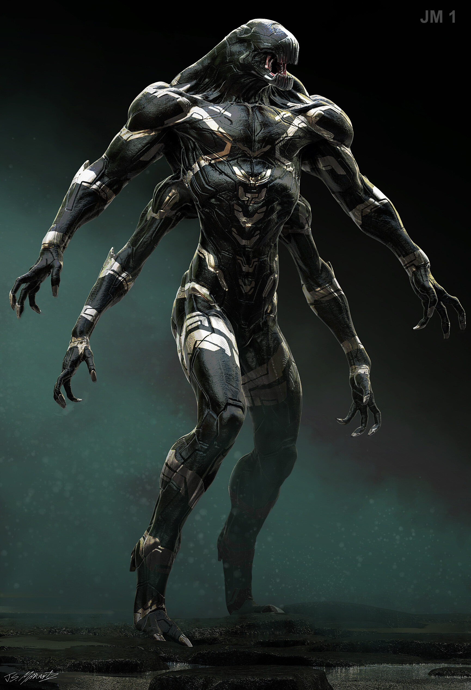</td>
      <td>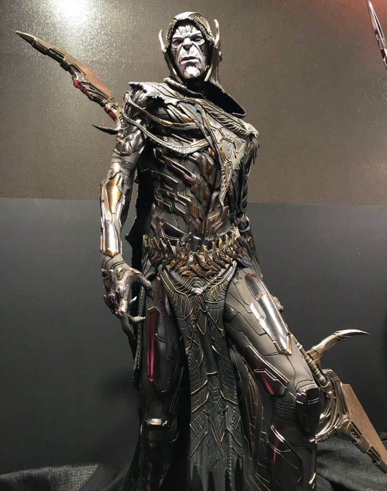</td>
      <td>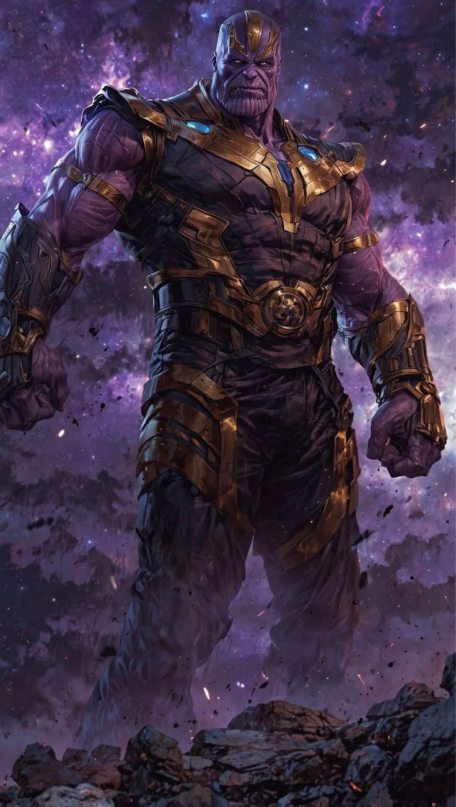</td>
    </tr>
  </table>
</div>

*Todas as imagens foram retiradas do **Pinterest**.

## ⚙️ Como compilar e executar

O projeto foi escrito em C (Padrão C99) e utiliza múltiplos arquivos. Para rodá-lo, você precisará de um compilador C, como o `gcc`, instalado na sua máquina.

### Passo 1: Abrir o Terminal e Navegar até o Projeto

Abra o terminal (ou Prompt de Comando/PowerShell no Windows) e navegue até a **pasta raiz** do projeto (onde estão as pastas `src`, `images`, `video` e o `README.md`). Use o comando `cd` para isso:

```bash
cd caminho/para/a/pasta/rpg-vingadores
```

### Passo 2: Compilar o jogo

Como o projeto está dividido em dois arquivos `.c` (`main.c` e `vingadores.c`), você precisa compilá-los juntos. Copie e cole o comando de acordo com o seu sistema operacional:

**No Linux ou macOS:**
```bash
gcc src/main.c src/vingadores.c -o jogo
```

**No Windows (Prompt de Comando ou PowerShell):**
```bash
gcc src\main.c src\vingadores.c -o jogo.exe
```
A flag `-o` (output) cria o arquivo executável com o nome jogo ou jogo.exe na raiz do projeto.

### Passo 3: Executar o jogo

Se o comando de compilar rodar sem nenhuma mensagem de erro, o executável foi criado. Para jogar, digite:

**No Linux ou macOS:**
```bash
./jogo
```

**No Windows:**
```bash
.\jogo.exe
```

## 📂 Estrutura do código

O projeto foi modularizado para garantir a legibilidade e a separação de responsabilidades. A estrutura de arquivos e os principais componentes são:

*   **`src/main.c`**: Ponto de entrada. Contém a função `main`, o loop principal e o controle de fluxo.
*   **`src/vingadores.h`**: Cabeçalho com a declaração de `enums`, `structs` e protótipos.
*   **`src/vingadores.c`**: Implementação da lógica, funções de combate, tabuleiro e progressão.

### Principais `enums` e `structs`

*   **`ClassePersonagem`**: Define as classes (Hulk, Homem de Ferro, Viúva Negra).
*   **`TipoCasa`**: Define os eventos do tabuleiro (Vazia, Combate, Tesouro, etc.).
*   **`Personagem`**: Struct com nome, atributos (vida, força, etc.), equipamentos e cooldown.
*   **`Monstro`**: Struct com nome, atributos de combate e status (derrotado ou não).
*   **`Fase`**: Struct com nome, missão, array de monstros e status da missão.

### Principais funções

*   **`escolherPersonagem()`**: Exibe as fichas e configura o herói escolhido.
*   **`inicializarFases()`**: Popula as fases com seus monstros e missões.
*   **`iniciarTabuleiro()`**: Gera o tabuleiro aleatório garantindo no mínimo 2 combates.
*   **`iniciarCombate()`**: Gerencia o loop de combate por turnos.
*   **`turnoJogador()` e `turnoMonstro()`**: Executam as ações de cada lado.
*   **`ganharXP()` e `aplicarBonusAleatorio()`**: Controlam a progressão do herói.

## Finalização e agradecimento 
Espero que goste. Obrigada por ter lido! ❤️


